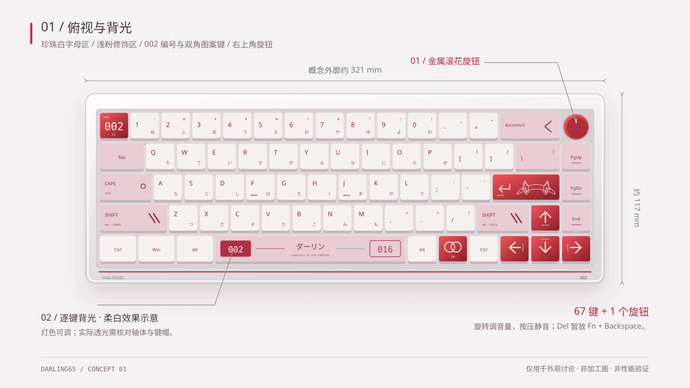
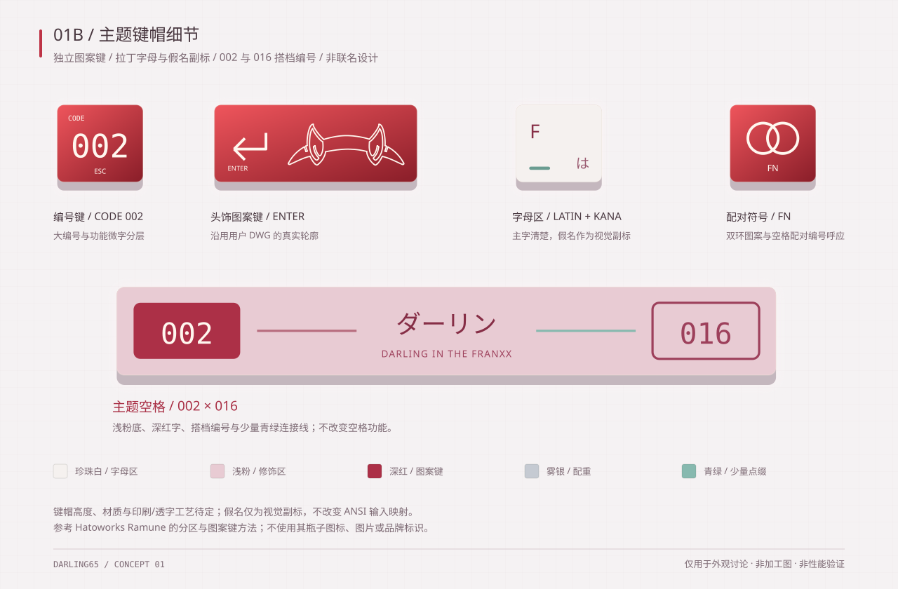
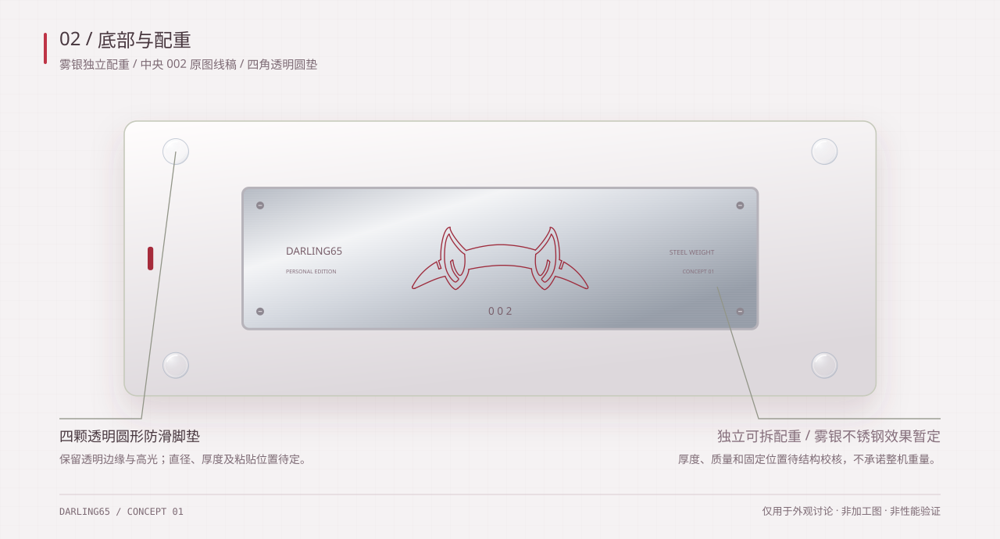
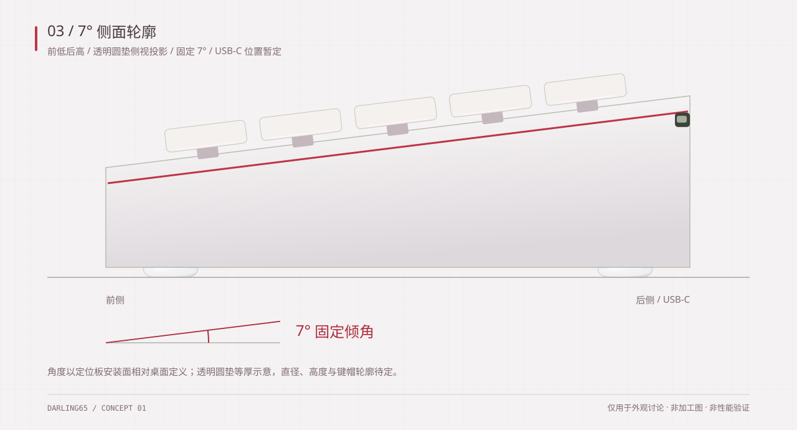

# DARLING65 设计草案

**状态：草案与外观概念评审。已绘制 SVG 概念图；尚未开展 PCB、可加工外壳 CAD 或固件实现。**

**项目方向：** 制作一把《DARLING in the FRANXX》主题的 65% 机械键盘，轴体暂定水月雨（MOONDROP）「月华轴」，保留 QMK / VIA 支持，仅采用 USB-C 有线连接，以真正的 8 kHz USB HID 轮询为性能目标。

以上轮询率是设计目标，并非 DARLING65 硬件的实测结果。配列细节、外观、电子元件及预算仍需确认；月华轴的具体版本、参数和封装兼容性也需核对。

## 外观概念图 · REV 01

本轮加入逐键背光、独立配重、一个旋钮，以及 **7° 固定打字倾角**。本轮以珍珠白、浅粉和深红为主色，金属配重改用雾银效果。

[打开概念图预览页](design/concepts/index.html) · [俯视原图](design/concepts/top.svg) · [底部原图](design/concepts/bottom.svg) · [侧面原图](design/concepts/side.svg)









图中约 321 × 117 mm 的外廓、前后高度、旋钮尺寸、配重形状及固定点仅用于比例讨论，尚未做月华轴、轴座、编码器或内部结构的适配校核，不能用于加工。7° 是本轮确定的输入角度，按定位板安装面相对桌面定义。

重新生成概念图：`python3 design/concepts/generate.py`；检查图纸与源文件一致：`python3 design/concepts/generate.py --check`。

## 1. 产品定位

制作一把兼顾日常输入与游戏的紧凑键盘，保留独立方向键，重视输入延迟的一致性、连接稳定性和后期维护。

优先采用常见键帽规格及可更换轴体的结构，避免因主题造型而使用难以购买的异形键帽。

外观暂建议以「02 / Zero Two」为灵感，通过配色、小面积标识和背部装饰体现主题，而非铺满角色图案。具体角色及配色尚未确定。

## 2. 需求与暂定方案

| 项目 | 要求或暂定方案 | 状态 |
| --- | --- | --- |
| 尺寸 | 65%，保留独立方向键 | 已提出 |
| 主题 | 《DARLING in the FRANXX》 | 已提出 |
| 轴体类型 | 传统机械轴，不采用霍尔传感方案 | 已确认调整 |
| 预计轴体 | 水月雨（MOONDROP）月华轴 | 用户暂定；具体版本与规格待核对 |
| 连接方式 | 仅 USB-C 有线，目标为真正的 8 kHz USB HID 轮询 | 已确认连接方式；性能待验证 |
| 固件 | 实际运行 QMK，并支持 VIA 改键 | 已提出；实现可行性待验证 |
| 配列 | ANSI，概念图为 67 键加 1 个旋钮，保留方向键及右侧导航键 | 位置与键位分配为建议方案 |
| 轴座 | 优先考虑 MX 兼容热插拔；核对月华轴后确定具体封装 | 建议方案 |
| 键帽规格 | 标准 6.25u 空格、1.75u 右 Shift | 建议方案 |
| 卫星轴 | 大键使用 PCB 安装式卫星轴 | 建议方案 |
| 供电 | USB 总线供电 | 随有线方案调整 |
| 外壳打样 | 先打印装配样件，再决定是否 CNC 加工 | 建议方案 |
| 背光 | 需要背光；暂建议逐键 RGB，图中以柔白效果展示 | 需求已提出；灯色与方案待确认 |
| 配重 | 底部独立可拆配重，暂建议雾银色不锈钢 | 需求已提出；材质、厚度与质量待定 |
| 脚垫 | 四颗透明圆形防滑脚垫，替代原长条脚垫 | 外观要求已提出；尺寸、材质与胶粘方式待定 |
| 旋钮 | 一个带按压功能的旋钮，暂放右上角 | 用户希望加入；功能与位置待确认 |
| 打字倾角 | 定位板安装面相对桌面固定为 7° | 已提出 |

本草案不包含模拟触发和 Rapid Trigger，也暂不加入屏幕。

## 3. 外观方向

### 暂定「02」主题配色

| 部位 | 建议方向 |
| --- | --- |
| 外壳主体 | 珍珠白，哑光表面 |
| 点缀色 | 深红，用于背部饰条、铭牌或局部细节 |
| 辅助色 | 浅粉修饰键与空格、珍珠白底行、雾银配重；保留少量青绿定位 |
| 文字标识 | 小面积 `DARLING65`、`002` |
| 可选图案 | 可拆卸铭牌上的双角轮廓 |

### 主题键帽方案

参考 [Hatoworks 官方 Ramune 系列](https://hatoworks.com/collections) 的设计分工：基础字母区保持可读，通过色彩分区和少数独立图案键体现主题。不使用其汽水瓶图案、照片或品牌标识，也不代表联名。

| 区域 | 本轮设计 |
| --- | --- |
| 字母与数字区 | 珍珠白底、深红主字、较小假名副标；数字保留 ANSI 对应的 Shift 符号 |
| 修饰键 | 浅粉与珍珠白分区，Shift 加搭档编号与斜线元素 |
| Esc | 深红底，大号 `002`，保留小号 `ESC` 功能字 |
| Enter | 使用用户 DWG 中的真实双角头饰轮廓，并保留回车箭头及功能字 |
| 空格 | 浅粉底、深红字，`002 / 016` 搭档编号、`ダーリン` 主题字及双色连接线 |
| Fn | 双环配对图案，同时保留 `FN` 功能字 |
| 方向键与定位点 | 自绘方向箭头及少量青绿点缀，与整套配色呼应 |

[查看键帽放大图](design/concepts/keycaps.svg)。假名只是视觉副标，不将 ANSI 配列改成 JIS，也不会改变系统输入或 QMK 键位。字符与图案仍需做实际尺寸、对比度和细线打样检查。

图中为键帽顶面印刷效果，不默认图案或字符可以透光。材质、键帽高度、热升华/双色注塑/其他印刷工艺及透字方案均未确定；键间背光与字符透光需分开评估。

若最终选择铝合金外壳，可考虑珍珠白涂层和红色嵌件。待预算明确后再确定材质、表面工艺和加工方式。当前不确定外壳尺寸、壁厚、重量或装饰图案。

本轮配重标识参考用户提供的 DWG，其余装饰尽量使用原创元素。若公开发布或销售设计，需确认参考 DWG 图案及官方角色元素的授权。

### 背光、旋钮与配重

背光先以逐键灯光为方案，概念图使用柔白色。深红细线属于外壳装饰，不默认增加整圈灯带。月华轴与所选键帽能否透光尚未核对；若希望字符发光，需另外确认透光键帽、LED 位置及光路。灯色与 RGB 实现均未定案。

旋钮暂放右上角，默认旋转调节音量、按压静音。概念图用旋钮替代原顶行 Del 位置，Del 暂映射到 `Fn + Backspace`；底行保留一个右 Ctrl，因此图中为 67 个机械按键加 1 个旋钮。该分配尚需确认，编码器型号、帽径、轴高及 VIA 配置方式待验证。

配重暂建议使用不锈钢，并以雾银色表面效果展示，放在底部中央，与脚垫分离。具体钢种、拉丝或喷砂工艺及质量均未定案。配重正中央采用用户提供的 `zuoer68榴芒68改02图案(1).dwg` 中的 002 双角头饰线稿，直接提取原始矢量轮廓、保持比例缩放，不再使用先前自由绘制的实心角。下方居中标注 `002`，两侧保留小字。仅复用局部图案，不沿用原键盘的尺寸与结构，原 DWG 未修改。[查看提取的参考线稿](design/concepts/zero-two-reference.svg)。深红线色仅为外观效果，雕刻填色等工艺待定。后续核对厚度、固定螺钉、绝缘及内部净空后再计算质量，不凭概念图承诺整机重量或声音表现。

### 透明圆形脚垫

底部四角改为四颗透明圆形防滑脚垫，图中用半透明边缘与高光表现，不再使用长条形脚垫。圆垫的直径、受压厚度、硬度、材质及胶粘方式均待确认，后续还需检查防滑、抗黄变和脱胶风险。

前后脚垫按相同受压高度考虑，避免高度差改变打字倾角。侧图中的两个轮廓代表前后两组脚垫的重合投影，实际仍为四颗；图示厚度仅用于外观比例，最终应通过装配样件验证 7° 倾角。

## 4. 配列、轴体与手感

### 配列建议

采用常规 ANSI 65% 配列，保留方向键和少量导航键。当前概念图将 Del 放到 `Fn + Backspace`，为右上角旋钮留出位置。通过 QMK 层与 VIA 改键提供功能键及其他导航功能。

优先使用常见键帽尺寸。正式绘制配列、摆放轴体前，需确认总键数、底行规格和导航键安排。

### 预计采用：水月雨月华轴

轴体暂定为水月雨（MOONDROP）「月华轴」，作为后续键盘手感、热插拔兼容性和消抖测试的主要参考。

当前尚未核对该轴体的具体版本及官方规格，因此不预设其触发压力、触发行程、总行程、针脚数量、出厂润滑方式或寿命。开始实际设计前，需要确认：

- 具体产品型号或购买链接，避免混淆版本。
- 针脚与定位柱布局，以及和拟选热插拔轴座的兼容性。
- 外壳、定位板卡扣和键帽十字轴接口的机械适配。
- 实际弹跳、连击表现及手感，用于消抖参数和结构选择。

热插拔方案仍属于建议，不将「月华轴」直接等同于已经验证过的某种 PCB 封装。更换机械轴也不直接改变 USB 轮询率。

### 结构手感

后续可比较偏硬朗的固定结构与轻度隔振结构。更软的敲击手感不要求降低电气扫描速度。

输入角度按定位板安装面相对桌面固定为 7°，不是每颗键帽顶面的角度。定位板材质、固定方式、键帽高度和外壳前沿高度暂不确定，待轴体体验和预算明确后再选择；侧视图中的高度仅为示意。

## 5. 性能目标

### USB-C 有线性能

- 以 USB 2.0 High-Speed 设备枚举，配置支持 8 kHz 轮询的 HID 端点，即每 125 微秒一次轮询机会。
- 目标为整张按键矩阵每秒完成至少 8,000 次扫描，并让按键处理跟上扫描速度。
- 避免灯光、配置写入和日志任务阻塞输入处理。
- 在正常工作模式下支持 NKRO，并验证主机兼容性。

USB-C 只代表接口形式，不代表 USB 数据速度。主控与 PHY 必须支持 High-Speed USB。即使矩阵扫描很快，只有 Full-Speed USB 的控制器也无法提供标准的 8 kHz HID 轮询。

125 微秒的轮询间隔不等于 125 微秒端到端延迟。轴体触点、消抖、固件调度和主机处理都会产生额外延迟。按键状态没有变化时，也不要求每次轮询都传输新的 HID 数据报告。

### 消抖策略

优先评估逐键、按下即时响应的消抖方式，以减少额外按下延迟。具体锁定窗口及松开处理方式，应参考月华轴样品的弹跳和连击测试，而非直接套用固定参数。

不在测试前承诺「零消抖」或某个固定响应时间。后续分别记录按下、松开的延迟中位数、高百分位数和最差观测值。

## 6. 电子系统概念

本节仅说明功能组成，不构成原理图或最终元件选型。

```text
机械轴矩阵 + 每键二极管
        |
键盘主控 / QMK
        |
High-Speed USB -> USB-C -> 电脑

USB 总线经保护及稳压电路为键盘供电。
```

### 键盘主控

主控需要具备足够的矩阵 GPIO、High-Speed USB 能力，以及处理矩阵扫描和 USB 上报的性能余量。优先考虑已有支持基础或便于审查的 QMK 平台，避免未经评估就开始新的平台移植。

公开项目 `baram-qmk-8k` 列出了 STM32U5A5、8 kHz 轮询、不低于 8 kHz 扫描和 VIA 支持，可作为参考。但作者对其描述是基于 QMK 的按键处理，这并不直接证明它满足本项目「实际运行 QMK」的要求，也不代表可以直接作为本项目的键盘移植基础。

确定主控前，需要审查固件结构、开源许可、USB 实现及配套硬件要求。当前不确定主控型号、引脚分配、时钟电路或 USB PHY。

### PCB 与 USB

暂建议考虑四层 PCB，以提供地平面、布线空间和更好的 USB 信号完整性；具体叠层及成本待评估。每键使用二极管，确定板框前核对月华轴、热插拔轴座和卫星轴相关封装。

可更换的 USB-C 子板有利于维修，但连接器、线材、保护元件和走线必须适合 480 Mbit/s USB。不能默认面向 Full-Speed 键盘的子板也能满足 High-Speed 要求。

## 7. QMK 与 VIA

保留以下两个独立要求：

1. 实际运行 QMK，负责键盘行为、层和按键处理。
2. 提供匹配的键盘定义文件，支持 VIA 改键。

仅模拟 VIA 协议的自定义固件不等于运行 QMK。可以评估厂商分支，但需先审查源码、构建流程和维护成本。本草案不承诺上游 QMK 收录，也不承诺 VIA 自动识别。

High-Speed USB 支持、8 kHz 输入处理和 VIA 配置兼容性是主要固件验证项，应在详细 PCB 设计前解决。

通过 USB-C 连接使用 VIA 配置，并验证保存配置及灯光操作不会阻塞输入处理。

## 8. 电源、外壳与维护

采用 USB 总线供电。评估主控、逐键背光和旋钮相关电路的总功耗，并设置灯光亮度或总电流限制，确保配置及工作电流符合 USB 供电要求。电源方案需考虑输入保护、稳压、上电行为和温升。

外壳需预留 USB 接口、线缆、旋钮编码器、背光光路、独立配重、固定结构及维护空间。金属外壳应考虑绝缘和静电防护，避免结构件接触 PCB 裸露导体。

复位和 Boot 恢复操作应尽量无需完全拆解键盘。考虑便于维修的 USB 接口，但暂不确定具体位置。

## 9. 草案确认后的验证要求

| 项目 | 宣称达标前需要的依据 |
| --- | --- |
| 固件基础 | 可复现的 QMK 构建、源码与许可审查，以及 VIA 配置读写验证 |
| 有线 USB | High-Speed 枚举与端点验证，并通过分析仪或等效方法检查负载下的时序 |
| 矩阵 | 整张矩阵扫描时序、多键同时按下，以及按下和松开的处理测量 |
| 轴体与消抖 | 核对月华轴型号、针脚及结构兼容性；使用样品检查连击、误触发和丢失的状态变化 |
| 电源 | USB 工作与挂起电流、供电要求、输入保护、上电行为及温升 |
| 背光与旋钮 | 验证光路、亮度、电流限制、旋转与按压功能，以及灯光任务不阻塞输入 |
| 机械结构 | 打印样件检查 7° 倾角、透明圆垫的受压高度与防滑、轴体、轴座、卫星轴、旋钮、配重、USB 及装配维护空间 |
| PCB 发布 | 原理图及 ERC 审查、布线 DRC、封装检查和小批装配验证 |

浏览器轮询率测试不足以单独证明 USB 时序或整体输入延迟。固件能够编译，也不能证明硬件性能已经达标。

## 10. 预算与主要风险

预算和数量尚未确定。后续应区分研发打样费用与单把成品成本，分别考虑：

- 开发板，以及时序测量设备的使用成本。
- PCB 制造、贴片装配、热插拔轴座和 USB 相关元件。
- 月华轴、卫星轴、背光及驱动、旋钮编码器与旋钮帽、定位板、键帽、配重及外壳。
- 运费、装配损耗及可能发生的 PCB 改版。

主要技术风险包括 QMK 与 High-Speed USB 的组合、8 kHz 扫描与上报的一致性、轴体消抖，以及 USB 信号完整性和供电预算。打印样件能降低外壳修改成本，但不能替代电子系统验证。

## 11. 草案待确认事项

| 决策 | 当前建议或状态 |
| --- | --- |
| 角色与视觉方向 | 暂建议「02」主题，珍珠白、浅粉与深红配色，配重采用雾银效果 |
| 配列 | ANSI 65%，概念图为 67 键加 1 个旋钮；Del 暂放 Fn + Backspace |
| 轴体 | 暂定水月雨月华轴，需确认具体型号或产品链接 |
| 轴体安装 | 优先热插拔，待核对月华轴与轴座的兼容性 |
| 外壳路线 | 先打印样件，装配验证后再考虑铝壳 |
| 结构手感 | 结合月华轴体验确定软硬程度、声音及固定方式 |
| 背光 | 已要求加入；暂建议逐键 RGB，柔白效果示意，需确认键帽透光需求 |
| 旋钮 | 已提出加入意向；暂放右上角，旋转音量、按压静音 |
| 配重 | 已要求加入；暂用底部独立不锈钢配重，雾银效果示意，质量待核算 |
| 打字倾角 | 已明确为 7°，需后续样件测量验证 |
| VIA 配置 | 通过 USB-C 配置，需验证与 8 kHz 输入处理的兼容性 |
| 预算与数量 | 在元件选型和制造方式确定前明确 |

确认或修改以上内容后，再开展正式配列文件、原理图、PCB 布线、定位板与可加工外壳 CAD、固件及生产 BOM。当前阶段仅有 README 草案、外观 SVG 概念图及其生成与预览文件。

## 参考资料

- [Hatoworks 官方 Ramune 键帽设计](https://hatoworks.com/collections)：仅参考色彩分区、双字符布局与主题图案键的方法，不复用其素材。

- [QMK 配置选项](https://docs.qmk.fm/config_options)。
- [QMK 消抖说明](https://docs.qmk.fm/feature_debounce_type)。
- [VIA 自定义界面与固件集成](https://www.caniusevia.com/docs/custom_ui)。
- [baram-qmk-8k 参考实现](https://github.com/chcbaram/baram-qmk-8k)。其中列出的性能属于参考项目的描述，不代表 DARLING65 的实测结果。
